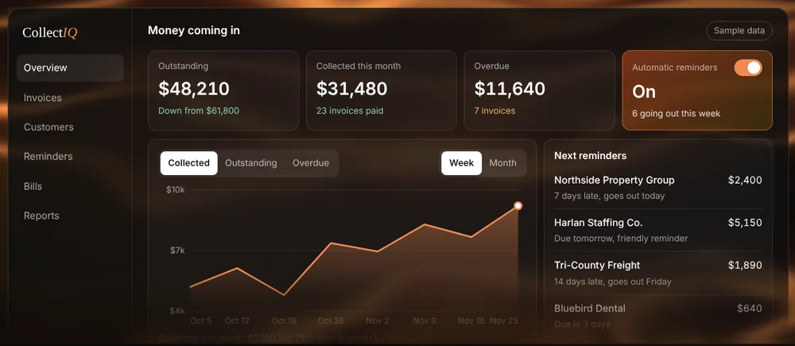
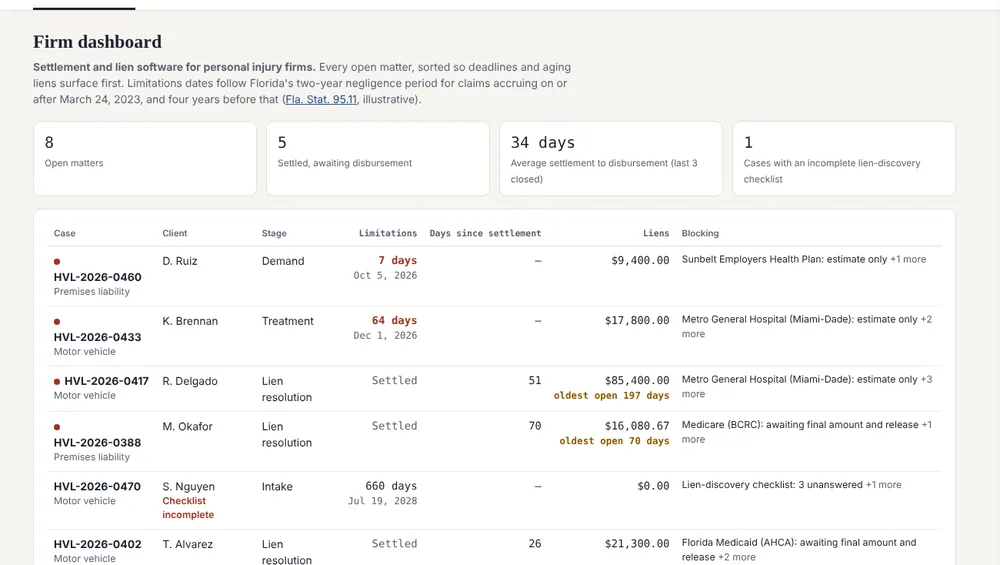
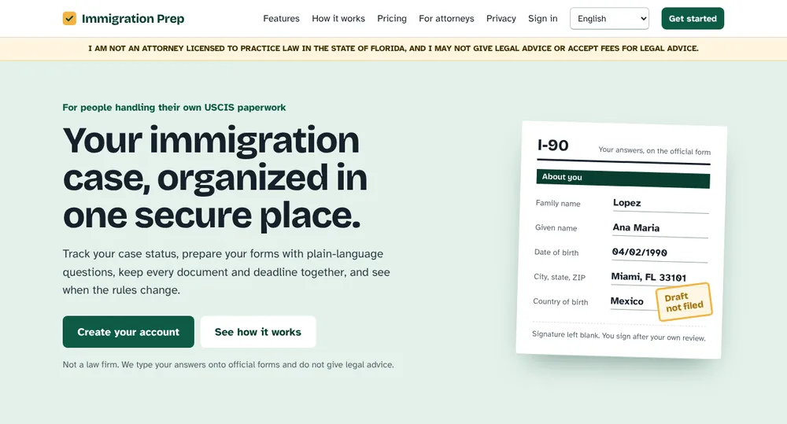
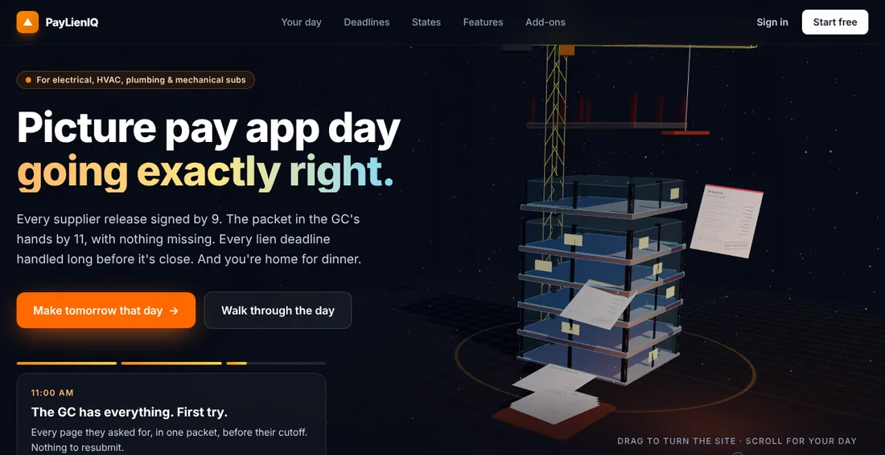
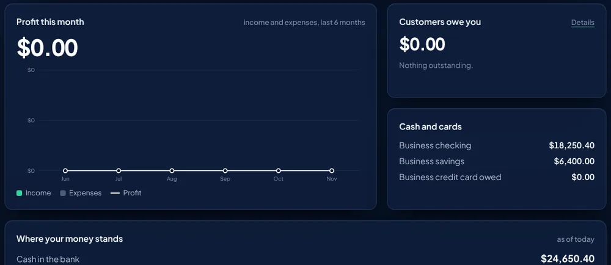
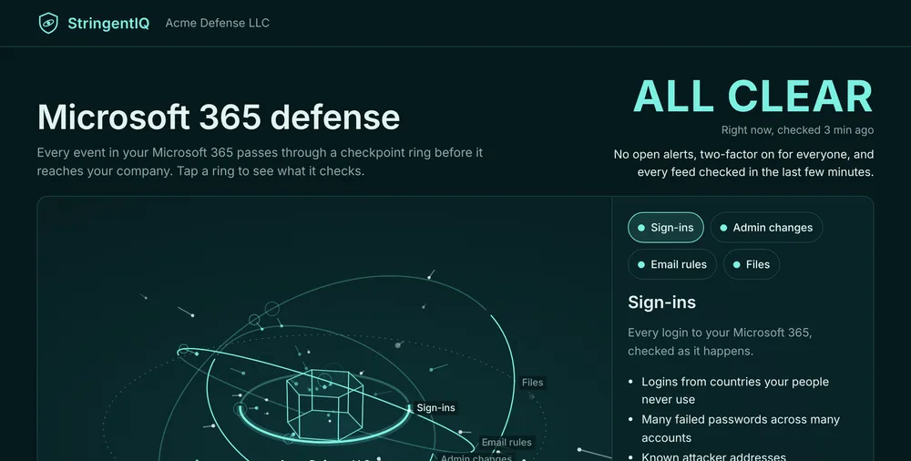
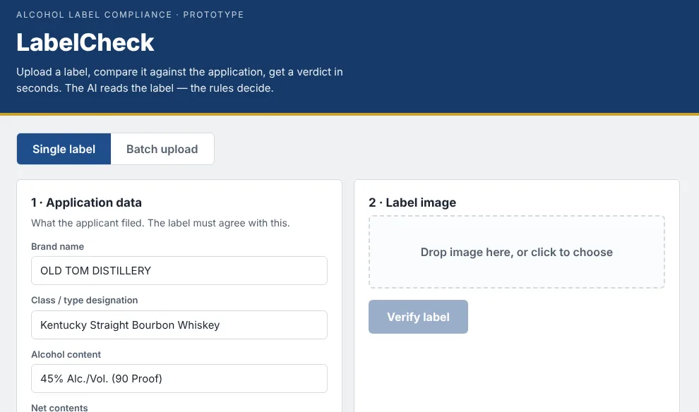
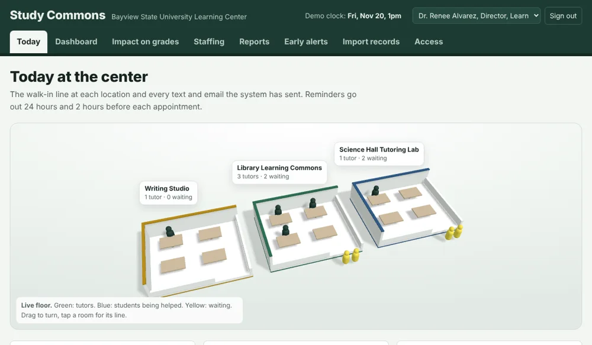
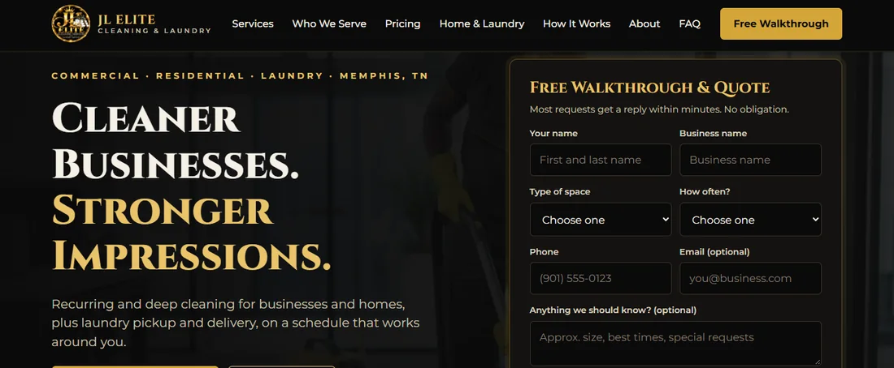

# Kinecia Wheeler · CollectIQ Technologies

I build software for businesses: accounts receivable, accounting, legal and compliance tools, and websites. Most of it uses AI, and a person approves every decision that matters. I'm the founder of CollectIQ Technologies LLC, based in Miami.

**My product and client code lives in private repositories.** Below is live work you can open and try. I'm glad to walk through the code on a screen share or give read access to a relevant repository.

- Website: [trycollectiq.com](https://trycollectiq.com)
- Custom software: [trycollectiq.com/custom-software](https://trycollectiq.com/custom-software)
- Email: hello@trycollectiq.com

---

## Products in production

### CollectIQ: accounts receivable platform
Accounts scored by risk, follow-up sent under the client's own name, a payment portal and a full audit trail. Bills, purchase orders and batch payment runs on the payables side.
[Live site](https://trycollectiq.com)

### Settlement & Lien Tracker
For personal injury firms. Every letter and every disbursement waits for the attorney's approval. New firms start a free trial on fictional practice cases.
[Try it](https://lien-tracker-production.up.railway.app/signup)

### USCIS form preparation app
Types a person's own answers onto 16 official USCIS forms, in eight languages, with documents, deadlines and case status in one place. It gives no advice and files nothing. Attorneys get a separate, verified workspace.
[Live app](https://immigration-prep-production.up.railway.app)

### PayLienIQ
Pay app day for electrical, HVAC, plumbing and mechanical subcontractors. Tracks lien deadlines in 18 states, Florida first, collects lien waivers signed from a phone, and sends the pay app packet to the general contractor in one click.
[Live app](https://web-production-a1fbe196.up.railway.app)

### YarehIQ: accounting system
Keeps the books for several of our own companies, with bank statement imports and automatic matching.
[Live site](https://www.yarehiq.com/welcome)

## Prototypes

### StringentIQ
Security for small businesses on Microsoft 365. Checks sign-ins, admin changes, email rules and files, explains each alert in plain English, and offers fixes that run only after the owner approves.

### LabelCheck
Reads label artwork with OCR, checks each field against the application data, and gives a pass, warn or fail verdict linked to the regulation. A person reviews every result.
[Try the prototype](https://ttb-label-verify.netlify.app/)

### Learning center platform
One system for a university tutoring and writing center: appointments, faculty referrals by text, and outcome reports for leadership.

### Intake Readiness Simulator
Capacity modelling for a multi-stage intake pipeline, with percentile bands and seeded runs that reproduce exactly.
[Try the prototype](https://collectiq-readiness-sim.netlify.app/)

## Websites

### JL Elite Cleaning & Laundry
For a cleaning company in Memphis. The quote form is on the first screen, next to a button to text the owner.
[jlelitecleaningservices.com](https://jlelitecleaningservices.com/)

### Suits & Circuits
Home of a ten-episode vertical series filmed in Miami, our own production. Pick a side, open character files, work an evidence wall and watch every episode.
[suitsandcircuits.com](https://suitsandcircuits.com/)

---

**How I work:** what "done" means is written down and agreed before coding starts, work is delivered in pieces you can check, and every written requirement has a test.

**Tools I use:** JavaScript and Node.js, HTML/CSS, Python, PostgreSQL and Supabase, Netlify, Railway, Stripe, AI document reading, QuickBooks, Xero and NetSuite APIs.
